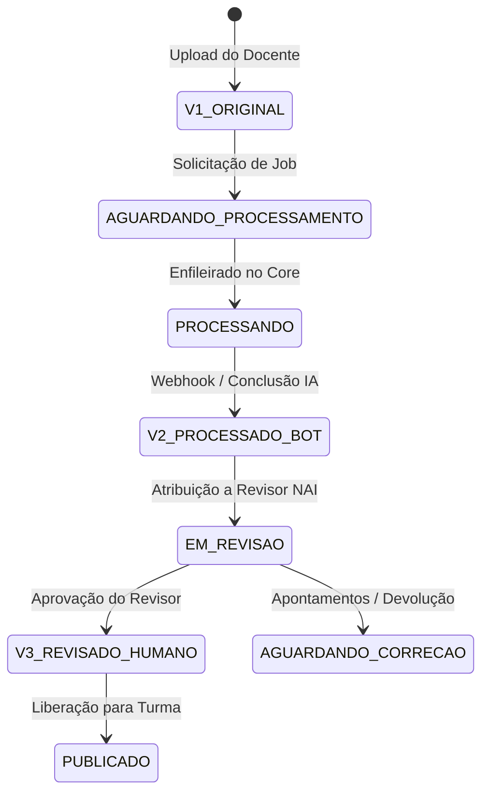

# Arquitetura e Engenharia do Sistema — Acessilia Gestor

Este documento consolida os princípios de arquitetura, padrões de projeto, segurança defensiva e a máquina de estados implementada no **Acessilia Gestor**.

---

## 1. Visão Geral da Arquitetura

O sistema é construído sobre o ecossistema **Node.js** com o framework de alta performance **Fastify**, utilizando uma arquitetura em camadas estritamente desacoplada:

```
┌────────────────────────────────────────────────────────┐
│               Interface do Usuário (EJS)               │
│        HTML5 Semântico, WCAG 2.2 AAA, CSS3, JS         │
└───────────────────────────┬────────────────────────────┘
                            │ HTTP / SSE
┌───────────────────────────▼────────────────────────────┐
│                  Rotas Fastify (Web & API)             │
│        Validação de Entrada, CSRF e Rate Limiting      │
└───────────────────────────┬────────────────────────────┘
                            │
┌───────────────────────────▼────────────────────────────┐
│                 Camada de Serviços (Services)          │
│       Regras de Negócio, Escopo RBAC e Transações      │
└─────────────┬────────────────────────────┬─────────────┘
              │                            │
┌─────────────▼──────────────┐ ┌───────────▼─────────────┐
│  Repositórios (Repository) │ │  Integração (Bot-Acess) │
│ Consultas SQLite WAL seguras│ │  Cliente HTTP Core/IA  │
└─────────────┬──────────────┘ └─────────────────────────┘
              │
┌─────────────▼──────────────┐
│  Banco SQLite (WAL Mode)   │
│  30 tabelas relacionais    │
└────────────────────────────┘
```

---

## 2. Máquina de Estados e Ciclo Imutável de Versões

O sistema adota o princípio de **Trilha Imutável de Auditoria**. Cada alteração ou processamento de material gera um novo registro de versão em `material_versions`, preservando o histórico e os hashes criptográficos SHA-256.



### Tipos de Versão:
1. **`ORIGINAL` (v1):** Arquivo bruto submetido pelo docente.
2. **`PROCESSADO_BOT` (v2):** Documento gerado pela inteligência artificial do Acessilia Core (com audiodescrições de imagens, texto limpo e síntese de áudio).
3. **`REVISADO_HUMANO` (v3+):** Versão homologada por especialista do Núcleo de Acessibilidade (NAI), que confere o Selo Acessilia definitivo.

---

## 3. Modelo de Segurança e Governança

### 3.1 Criptografia de Senhas (Argon2id)
Implementada via biblioteca nativa `argon2`, configurada com parâmetros de memória e iteração resistentes a ataques por GPU e hardware dedicado.

### 3.2 Prevenção de IDOR (Insecure Direct Object Reference)
Em [src/services/material.service.js](../src/services/material.service.js), o método `canUserViewMaterial` e `canUserDownloadMaterial` verifica:
* Se o estudante está formalmente matriculado na turma vinculada ao material (`academicRepository.isStudentInClass`).
* Se a data de agendamento de liberação (`publish_at`) já foi atingida.
* Usuários de outras turmas ou desautenticados recebem resposta `403 Forbidden` com layout explicativo acessível.

### 3.3 Regra da Proteção do Último Administrador
O repositório de usuários impede que o único administrador ativo do sistema seja desativado ou rebaixado de função, prevenindo perda catastrófica de governança.

### 3.4 Proteção Contra Força Bruta
O plugin de autenticação monitora tentativas consecutivas incorretas em memória e no banco, aplicando bloqueio temporal escalonado.

---

## 4. Persistência e Alta Disponibilidade com SQLite

* **Modo WAL (Write-Ahead Logging):** Permite leitura e escrita simultâneas sem bloqueio de tabelas (`PRAGMA journal_mode = WAL`).
* **Integridade Referencial Ativa:** `PRAGMA foreign_keys = ON` em todas as conexões.
* **Backup a Quente:** Uso da `sqlite.backup()` da biblioteca `better-sqlite3`, permitindo capturas consistentes sem parar o servidor.

---

## 5. Diagramas Técnicos do Projeto

* **Diagrama de Sequência do Envio e Revisão:** [`docs/diagrams/sequence_submission.puml`](diagrams/sequence_submission.puml)
* **Diagrama de Classes e Domínio de Entidades:** [`docs/diagrams/classes_domain.puml`](diagrams/classes_domain.puml)
